# Mehmet Karataş

### Bilgisayar Mühendisi · Yazılım Geliştirici

**Web, mobil ve yapay zekâ ile fikirleri çalışan ürünlere dönüştürüyorum.**

*Computer Engineer building web, mobile and AI-powered products.*

---

## Merhaba, ben Mehmet 👋

İhtiyaçları anlayıp kullanılabilir yazılımlara dönüştürmeyi seviyorum. Mobil uygulamalar, web platformları, işletmelere özel yönetim sistemleri ve yapay zekâ entegrasyonları geliştiriyorum.

Projelerde arayüzden veritabanına kadar uçtan uca çalışıyorum. Modüler kod, anlaşılır kullanıcı deneyimi ve sürdürülebilir mimari benim için önemli. Flutter ile çok platformlu uygulamalar; React ve Next.js ile web ürünleri; Python ile yapay zekâ çözümleri üretiyorum.

Yeni projelere ve uzaktan iş birliklerine açığım.

## 🧰 Teknoloji çantam

### Programlama dilleri

**Dart · Python · JavaScript · TypeScript · C# · C · SQL**

### 📱 Mobil & web

**Flutter · React · React Native · Next.js · .NET MAUI · WPF · PyQt5**

### 🗄️ Backend & veri

**Node.js · PostgreSQL · Supabase · Firebase / Firestore · Redis · Socket.IO**

### 🧠 Yapay zekâ & görüntü işleme

## 🧩 Üzerinde çalıştığım alanlar

| Alan | Odak |
| :--- | :--- |
| 📱 Çok platformlu uygulamalar | Mobil, web ve masaüstü deneyimleri |
| 🏢 SaaS & işletme sistemleri | Çok kiracılı yapı, abonelik ve yönetim panelleri |
| 🎓 Eğitim teknolojileri | Öğrenci takibi, program yönetimi ve analiz |
| 🧠 Yapay zekâ | Görüntü işleme, gerçek zamanlı algılama ve içerik otomasyonu |
| 🛠️ Ürün geliştirme | İhtiyaç analizi, kullanıcı deneyimi ve API entegrasyonları |

## 🚀 Seçilmiş projeler

| Proje | Ne yapıyor? | İncele |
| :--- | :--- | :--- |
| **🧭 Pusula Koç** | Eğitim koçluğu; program, görev, deneme, randevu ve veli takibi. | [Web sitesi](https://www.pusulakoc.com/) |
| **🎓 Koç Hocam Nur** | Ders programı ve koçluk süreçlerini birleştiren eğitim platformu. | [Canlı proje](https://kochocamnur.web.app/) |
| **📍 YerGöster** | Harita üzerinden emlak arama, filtreleme ve favori yönetimi. | [Web sitesi](https://www.yergoster.com/) |
| **📚 Kütüphanem** | Flutter tabanlı kitap ve okuma takibi; kartlar, quiz ve istatistikler. | [Portföy](https://www.benmuhendisiniz.com/projects) |
| **🗂️ Arşivim** | Kişisel belgeleri düzenleme ve cihazlar arasında senkronizasyon. | [Portföy](https://www.benmuhendisiniz.com/projects) |
| **📦 Malzemecim** | Çok platformlu envanter ve veresiye yönetimi. | [Canlı proje](https://malzemecim-app.web.app/) |
| **🔗 Linkcim** | Flutter ile video organizasyonu ve arama. | [Portföy](https://www.benmuhendisiniz.com/projects) |
| **💪 Vücut Akademi** | Fitness koçluğu platformu ve yönetim paneli. | [Web sitesi](https://www.vucutakademi.com/) |
| **🏗️ EMEG Taş Yapı** | Gayrimenkul ve inşaat hizmetleri için kurumsal web sitesi. | [Web sitesi](https://emegtasyapi.com/) |

**🍽️ Menumebak:** QR menü ve restoran otomasyonu.

**🛡️ Guard:** Yapay zekâ destekli düşme/bayılma algılama.

[Tüm projelerimi keşfet →](https://www.benmuhendisiniz.com/projects)

## 📊 GitHub'da çalışmalarım

*Bu kart herkese açık GitHub verilerinden oluşturulur; özel depolardaki tüm çalışmalarımı yansıtmayabilir.*

[Açık depolarım](https://github.com/mehmet-karataslar?tab=repositories) · [Katkı geçmişim](https://github.com/mehmet-karataslar?tab=overview)

Bazı projelerimin kaynak kodları özel depolarda bulunuyor. Ürünleri ve proje açıklamalarını portföy sitemden inceleyebilirsiniz.

## 🤝 Birlikte geliştirelim

Web sitesi, mobil uygulama, özel yazılım veya yapay zekâ entegrasyonu için iletişime geçebilirsiniz.

- **Web:** [benmuhendisiniz.com](https://www.benmuhendisiniz.com/)
- **E-posta:** [benmuhendisiniz@gmail.com](mailto:benmuhendisiniz@gmail.com)
- **LinkedIn:** [Mehmet Karataş](https://www.linkedin.com/in/mehmet-karata%C5%9F-830a22212/)

---

**İhtiyacı anlayalım. Çözümü tasarlayalım. Birlikte geliştirelim.**

