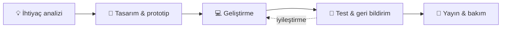
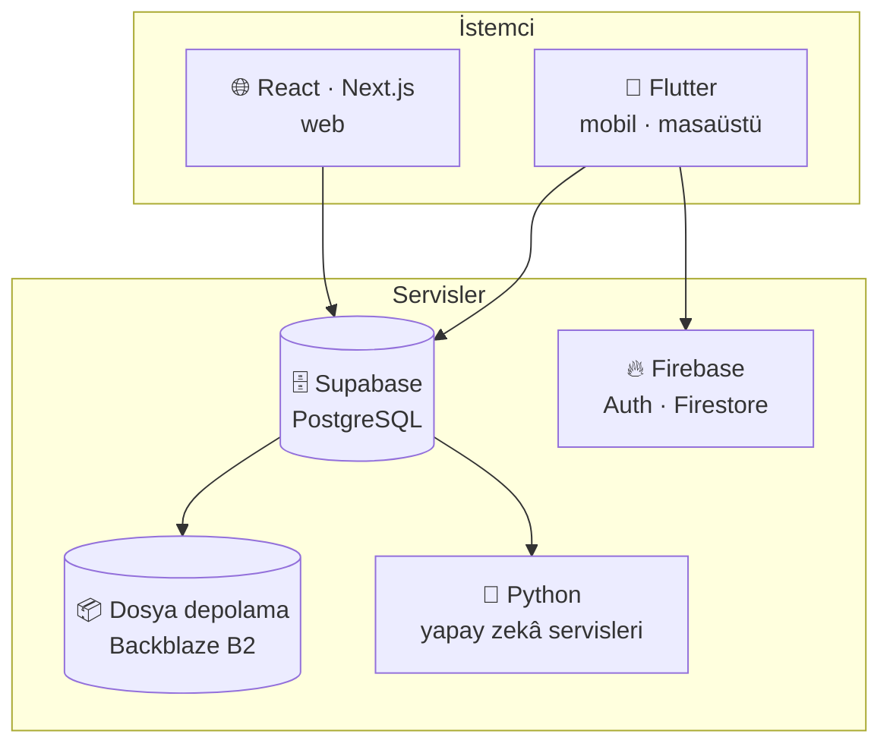

# Mehmet Karataş

### Bilgisayar Mühendisi · Yazılım Geliştirici

**Web, mobil ve yapay zekâ ile fikirleri çalışan ürünlere dönüştürüyorum.**

**Hızlı gezinti:** [Hakkımda](#hakkimda) · [Hizmetler](#hizmetler) · [Çalışma şeklim](#calisma) · [Teknolojiler](#teknoloji) · [Projeler](#projeler) · [İstatistikler](#istatistik) · [İletişim](#iletisim)

*Computer Engineer building web, mobile and AI-powered products.*

---

## 👋 Merhaba, ben Mehmet

İhtiyaçları anlayıp kullanılabilir yazılımlara dönüştürmeyi seviyorum. Mobil uygulamalar, web platformları, işletmelere özel yönetim sistemleri ve yapay zekâ entegrasyonları geliştiriyorum.

Projelerde arayüzden veritabanına kadar **uçtan uca** çalışıyorum. Modüler kod, anlaşılır kullanıcı deneyimi ve sürdürülebilir mimari benim için önemli.

<table>
<tr>
<td width="50%" valign="top">

**🎯 Odağım**

- 📱 Flutter ile çok platformlu uygulamalar
- 🌐 React ve Next.js ile web ürünleri
- 🧠 Python ile yapay zekâ çözümleri
- 🏢 İşletmeye özel yönetim sistemleri

</td>
<td width="50%" valign="top">

**⚙️ Çalışma prensiplerim**

- 🧩 Modüler ve okunabilir kod
- 🎨 Sade, anlaşılır kullanıcı deneyimi
- 🔁 Küçük adımlarla sürekli teslimat
- 🤖 Yapay zekâ destekli hızlı geliştirme

</td>
</tr>
</table>

> [!TIP]
> **Yeni projelere ve uzaktan iş birliklerine açığım.** Fikrini anlat, birlikte çalışan bir ürüne çevirelim.

---

## 🛠️ Neler yapıyorum?

<table>
<tr>
<td width="25%" align="center" valign="top">

### 📱
**Mobil uygulama**

Flutter ile çok platformlu, hızlı ve akıcı uygulamalar

</td>
<td width="25%" align="center" valign="top">

### 🌐
**Web platformu**

React ve Next.js ile modern, hızlı web siteleri ve paneller

</td>
<td width="25%" align="center" valign="top">

### 🏢
**Özel yazılım**

SaaS, envanter, eğitim ve işletme yönetim sistemleri

</td>
<td width="25%" align="center" valign="top">

### 🧠
**Yapay zekâ**

Görüntü işleme, gerçek zamanlı algılama ve içerik otomasyonu

</td>
</tr>
</table>

| Alan | Odak |
| :--- | :--- |
| 📱 Çok platformlu uygulamalar | Mobil, web ve masaüstü deneyimleri |
| 🏢 SaaS & işletme sistemleri | Çok kiracılı yapı, abonelik ve yönetim panelleri |
| 🎓 Eğitim teknolojileri | Öğrenci takibi, program yönetimi ve analiz |
| 🧠 Yapay zekâ | Görüntü işleme, gerçek zamanlı algılama ve içerik otomasyonu |
| 🔌 Entegrasyon | API bağlantıları, bildirimler, ödeme ve harici servisler |

---

## 🔄 Çalışma şeklim

Bir fikrin ürüne dönüşme yolu:

<b>🏗️ Tipik mimari yaklaşımım</b>

 

---

## 🧰 Teknoloji çantam

  

| Kategori | Teknolojiler |
| :--- | :--- |
| 💬 **Diller** |        |
| 📱 **Mobil & masaüstü** |      |
| 🌐 **Web** |   |
| 🗄️ **Backend & veri** |        |
| 🧠 **Yapay zekâ** |     |
| 🧰 **Araçlar** |     |

---

## 🚀 Seçilmiş projeler

| Proje | Kategori | Ne yapıyor? | Bağlantı |
| :--- | :--- | :--- | :--- |
| **🧭 Pusula Koç** | 🎓 Eğitim | Eğitim koçluğu; program, görev, deneme, randevu ve veli takibi. |  |
| **🎓 Koç Hocam Nur** | 🎓 Eğitim | Ders programı ve koçluk süreçlerini birleştiren eğitim platformu. |  |
| **📦 Malzemecim** | 🏢 İşletme | Çok platformlu envanter ve veresiye yönetimi. |  |
| **💪 Vücut Akademi** | 🏢 İşletme | Fitness koçluğu platformu ve yönetim paneli. |  |
| **📍 YerGöster** | 🏠 Emlak | Harita üzerinden emlak arama, filtreleme ve favori yönetimi. |  |
| **🏗️ EMEG Taş Yapı** | 🌐 Kurumsal | Gayrimenkul ve inşaat hizmetleri için kurumsal web sitesi. |  |
| **📚 Kütüphanem** | 📱 Mobil | Flutter tabanlı kitap ve okuma takibi; kartlar, quiz ve istatistikler. |  |
| **🗂️ Arşivim** | 📱 Mobil | Kişisel belgeleri düzenleme ve cihazlar arasında senkronizasyon. |  |
| **🔗 Linkcim** | 📱 Mobil | Flutter ile video organizasyonu ve arama. |  |
| **🍽️ Menumebak** | 🏢 İşletme | QR menü ve restoran otomasyonu. |  |
| **🛡️ Guard** | 🧠 Yapay zekâ | Yapay zekâ destekli düşme ve bayılma algılama. |  |

<!--
Yapay zekâ destekli web geliştirmeyi anlattığın YouTube içeriklerini göstermek istersen
aşağıdaki bölümü açıp kanal bağlantını yaz:

## 🎥 Eğitim içerikleri

Türkçe YouTube içeriklerimde yapay zekâ destekli web geliştirmeyi anlatıyorum.

-->

---

## 📈 GitHub commit geçmişim

Bu alan GitHub Actions tarafından 6 saatte bir otomatik güncellenir. Toplam, GitHub commit aramasında hesabıma atfedilen ve erişilebilen kayıtları gösterir. Standart erişimde herkese açık commitler sayılır.

[Commit güncelleme işlemleri](https://github.com/mehmet-karataslar/mehmet-karataslar/actions) · [GitHub depolarım](https://github.com/mehmet-karataslar?tab=repositories)

---

## 🤝 Birlikte geliştirelim

Web sitesi, mobil uygulama, özel yazılım veya yapay zekâ entegrasyonu için iletişime geçebilirsiniz.

<table>
<tr>
<td align="center" width="33%">

🌐 **Web**

[benmuhendisiniz.com](https://www.benmuhendisiniz.com/)

</td>
<td align="center" width="33%">

📧 **E-posta**

[benmuhendisiniz@gmail.com](mailto:benmuhendisiniz@gmail.com)

</td>
<td align="center" width="33%">

💼 **LinkedIn**

[Mehmet Karataş](https://www.linkedin.com/in/mehmet-karata%C5%9F-830a22212/)

</td>
</tr>
</table>

---

**İhtiyacı anlayalım. Çözümü tasarlayalım. Birlikte geliştirelim.**

Mehmet Karataş · Yazılım Geliştirici

